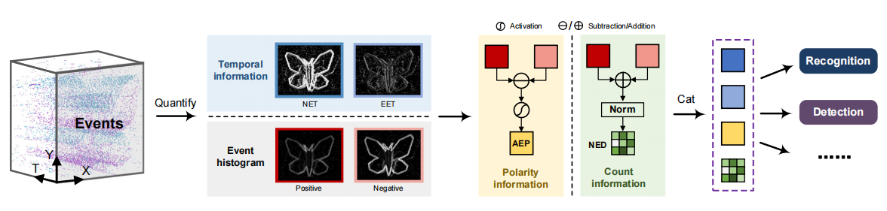

# EventPillars

The code for paper "EventPillars: Pillar-based Efficient Representations for Event Data" in AAAI2025. 

## Proposed representation

The dataset.py file contains encoding codes of Ncars data sets and Ncaltech datasets, using the event pillar encoding method described in the article. 

The encoded tensors include **NET**(Newest Event Timestamps), **EET**(Earlist Event Timestamps), **AEP**(Activated Event Polarity) and **NED**(Normalized Event Density)

##  Comparisons of representation time

For a fair comparison of encoding speeds, we used the scatter function used in [ERGO12](https://github.com/uzh-rpg/event_representation_study/blob/master/representations/representation_search/operations.py)

In the  representation time measurement, the representations methods of [HOTS](https://github.com/uzh-rpg/event_representation_study/blob/master/representations/time_surface.py)，[HATS](https://github.com/fabrizio-ottati/HATS/blob/main/hats.py)，[Voxel Grid](https://github.com/uzh-rpg/rpg_e2vid/blob/master/utils/inference_utils.py)，[DiST](https://github.com/82magnolia/n_imagenet/blob/main/real_cnn_model/data/imagenet.py)，[EST](https://github.com/uzh-rpg/rpg_event_representation_learning/blob/master/utils/models.py) all use open source code.

